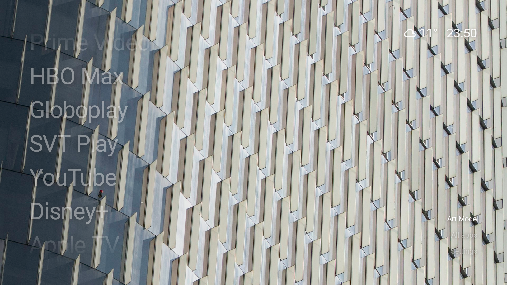

# CleanFrame

A quiet launcher for Android TV. The home screen is a photograph, a short list of apps, the time, and the weather. Nothing else competes with the picture.

It is inspired by [CleanFrame](https://github.com/nthnclrk/CleanFrame) by Nathan Clark, the home screen he made for a Samsung The Frame. This repository is a separate app for Android TV, written in Kotlin and Jetpack Compose. It is not a port of that project.



## What you get

- A text-only home. App names, no logos.
- The selected name stays in the middle. Up and down move the list around it, and the list wraps.
- A fade at the top and bottom when there are more apps than fit. The name in the middle is fully solid. The others sit back so the selection is obvious.
- The same idea horizontally in Dock layout.
- Art Mode and Dark. Art Mode shows a photograph and changes it every five minutes. Dark is black. The two crossfade, and the corner action is labeled with the mode you are in.
- Weather beside the clock: an icon and the temperature in Celsius, from the television’s approximate location. No API key.
- Settings for the background, the layout, the clock, and which apps are on Home, including their order.

CleanFrame does not replace the system home by itself. It only asks for that role if you choose **Use CleanFrame as Home**.

## Install

You need JDK 17, the Android SDK, and a device or emulator on Android 8.0 or newer. A television remote is the intended input. The app does not require a touchscreen.

```bash
./gradlew :app:assembleDebug
adb install -r app/build/outputs/apk/debug/app-debug.apk
adb shell am start -n tv.cleanframe/.MainActivity
```

`local.properties` is not in the repo. Android Studio writes it, or you can point it at your SDK:

```properties
sdk.dir=/path/to/Android/sdk
```

The debug package id is `tv.cleanframe`. The current version is 0.1.0.

## Remote

| Key | On Home |
| --- | --- |
| Up / Down | Move through the list. The highlighted name stays put and the list slides. |
| Left / Right | In the list, Right moves to the actions. In Dock, Left and Right move through apps. |
| OK | Open the selected app, or run the selected action. |
| Back | On Home, choose whether to stay or open Google TV. Elsewhere, go back. |

The actions on the right are **Art Mode** or **Dark**, **All apps**, and **Settings**.

## Home

### List

The list is on the left. Seven names are in view when you have at least that many apps. There is no cap on how many apps you can put on Home. The focused name is opaque white. The rest are dimmer, and the names at the very edges fade out.

The clock and weather sit at the top right. The actions sit at the bottom right.

### Dock

Settings → Layout → Dock puts the apps in a row along the bottom. The selected name stays in the center and the row slides left and right. Weather, the clock, and the actions share one line at the top.

### Art Mode and Dark

The corner action is a toggle, and its label is the mode you are already in.

- **Art Mode** shows a photograph. Turning it on picks the next picture immediately. After that, the picture changes every five minutes, in a shuffled order, and one photograph fades into the next.
- **Dark** is a black background. Turning Art Mode off lands here.
- Switching between them fades. It does not cut.

Settings still has **Photo** and **Dark** if you want to choose the background without the corner action. There is no light background.

### Weather and the clock

On launch, and again when you come back to the app, CleanFrame asks [geojs](https://www.geojs.io/) for a rough latitude and longitude from the public IP address, then asks [Open-Meteo](https://open-meteo.com/) for the current temperature and weather code. The icon is a Material Symbol. The temperature is Celsius. It refreshes about every 20 minutes.

The clock is 12-hour or 24-hour, from Settings.

## Settings

| Row | What it does |
| --- | --- |
| Photo | Show the photographs. |
| Dark | Black background, and leave Art Mode. |
| List / Dock | Vertical list or horizontal dock. |
| 12-hour clock / 24-hour clock | Clock format. |
| Arrange apps | Reorder Home, and add or remove apps. |
| Use CleanFrame as Home | Ask Android for the Home role. Skip this if you want Google TV to stay the home screen. |
| Google TV | Open the Google TV launcher. |
| Android settings | Open system settings. |

### Arrange apps

Home is the left column. Everything else is on the right.

- OK picks up an app. Up and down move it. OK puts it down.
- Right, on an app that is not being moved, removes it from Home. At least one app stays.
- OK on an app under **Not on Home** adds it.
- **Undo** puts the last change back.

**All apps** is the full alphabetical list. **Edit home** opens the same arranger. Apps already on Home are marked.

## Project

```
app/src/main/java/tv/cleanframe/
├── MainActivity.kt    Home, the carousels, clock, weather, Art Mode
├── Panels.kt          Settings, All apps, Arrange apps
├── HomeViewModel.kt   Preferences and edits
├── Models.kt          Modes, photographs, appearance
├── Catalog.kt         Installed apps, launching, the Home role
├── Weather.kt         Location and Open-Meteo
├── Symbols.kt         Material Symbols used for weather
└── Type.kt            Roboto and the type styles
```

Preferences live in DataStore, in the app’s private storage. Photographs are drawables, so Art Mode works with no network. Only the weather needs a connection.

| | |
| --- | --- |
| Language | Kotlin 2.0 |
| UI | Jetpack Compose (BOM 2024.10.01) |
| Android Gradle Plugin | 8.13 |
| Gradle | 8.14 |
| compileSdk | 36 |
| minSdk | 26 |
| targetSdk | 34 |
| JDK | 17 |

The APK is plain JVM bytecode. It does not ship native libraries, so the same build runs on 32-bit and 64-bit devices.

## Credits

The interaction and the calm layout follow [Nathan Clark’s CleanFrame](https://github.com/nthnclrk/CleanFrame).

[Roboto](https://fonts.google.com/specimen/Roboto) and [Material Symbols](https://fonts.google.com/icons) are from Google Fonts, under the Apache License 2.0.

Weather data is from [Open-Meteo](https://open-meteo.com/). The approximate location is from [geojs](https://www.geojs.io/).

The photographs are from Unsplash, bundled so the television does not have to download them. Unsplash+ pictures were left out because of the watermark.

| Picture | Unsplash |
| --- | --- |
| Waterfall | [unsplash.com/photos/-PXXLdZCpLo](https://unsplash.com/photos/-PXXLdZCpLo) |
| Ripples | [unsplash.com/photos/DqsNMBTk8ho](https://unsplash.com/photos/DqsNMBTk8ho) |
| Desert | [unsplash.com/photos/boTw8l3dRGc](https://unsplash.com/photos/boTw8l3dRGc) |
| Aurora | [unsplash.com/photos/2K08MjYTE2E](https://unsplash.com/photos/2K08MjYTE2E) |
| Golden | [unsplash.com/photos/pdGrQOGxW3c](https://unsplash.com/photos/pdGrQOGxW3c) |
| Tower | [unsplash.com/photos/CiF-oPmbios](https://unsplash.com/photos/CiF-oPmbios) |
| Koi | [unsplash.com/photos/jWB6YKxeFmk](https://unsplash.com/photos/jWB6YKxeFmk) |
| Frog | [unsplash.com/photos/WDH1NcUTAIs](https://unsplash.com/photos/WDH1NcUTAIs) |
| Curve | [unsplash.com/photos/9O3tbPRl8To](https://unsplash.com/photos/9O3tbPRl8To) |
| Brick | [unsplash.com/photos/ge-GutqptUo](https://unsplash.com/photos/ge-GutqptUo) |
| Oculus | [unsplash.com/photos/ecVubjlnT3I](https://unsplash.com/photos/ecVubjlnT3I) |
| Library | [unsplash.com/photos/gPGYhrbisXc](https://unsplash.com/photos/gPGYhrbisXc) |
| Arches | [unsplash.com/photos/WSvuTQGg6sg](https://unsplash.com/photos/WSvuTQGg6sg) |
| Figure | [unsplash.com/photos/_st7VQm0vi4](https://unsplash.com/photos/a-sculpture-of-a-person-made-out-of-windows-_st7VQm0vi4) |
| Slats | [unsplash.com/photos/Nnc4V87LIhQ](https://unsplash.com/photos/wooden-slats-create-a-beautiful-wavy-pattern-Nnc4V87LIhQ) |
| Facade | [unsplash.com/photos/bkw7EcP5SGM](https://unsplash.com/photos/modern-building-facade-with-abstract-geometric-window-pattern-bkw7EcP5SGM) |
